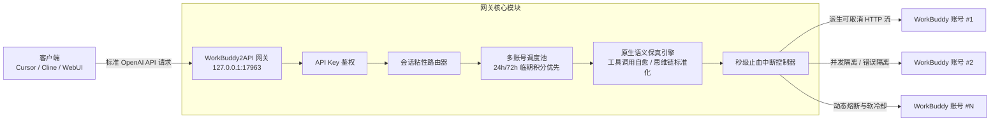

# WorkBuddy2API 部署与配置指南

<p align="center">
  <strong>将 WorkBuddy / CodeBuddy 账号无缝转换为原生保真度的 OpenAI 兼容 API 网关</strong><br>
  Docker / 无 Docker 双形态 · 多账号智能池化 · 秒级止血省积分 · Agent 工具调用完美保真
</p>

---

## 目录

- [一、项目简介与核心架构](#一项目简介与核心架构)
- [二、核心特性与原生级保真优化](#二核心特性与原生级保真优化)
- [三、快速开始](#三快速开始)
  - [方式 1：无 Docker 一条命令安装（推荐）](#方式-1无-docker-一条命令安装推荐)
  - [方式 2：Docker 部署（服务器 / 固定环境）](#方式-2docker-部署服务器--固定环境)
  - [方式 3：原生二进制直接运行（进阶）](#方式-3原生二进制直接运行进阶)
- [四、客户端接入配置（Cursor / Cline / Cherry Studio 等）](#四客户端接入配置)
- [五、可用模型清单与调用别名](#五可用模型清单与调用别名)
- [六、完整配置详解（config.json 逐项剖析）](#六完整配置详解configjson-逐项剖析)
- [七、多账号运维与调度机制](#七多账号运维与调度机制)
- [八、目录结构说明](#八目录结构说明)
- [九、常见问题与故障排查（FAQ）](#九常见问题与故障排查faq)
- [十、安全须知与合规免责](#十安全须知与合规免责)

---

## 一、项目简介与核心架构

**WorkBuddy2API** 是一个高性能、工业级的本地 AI 接口代理网关。它能将多个 WorkBuddy / CodeBuddy 账号的额度统一池化，向上层提供标准的 **OpenAI 兼容 HTTP 接口**（`/v1/chat/completions`、`/v1/models`）。

无论你使用 **Cursor、Cline、Roo Code、Cherry Studio、NextChat、Chatbox**，还是官方 **OpenAI Python / Node.js SDK**，均可实现零改造、低延迟、高并发的无缝接入。



---

## 二、核心特性与原生级保真优化

### 1. 客户端点击“停止生成”秒级中止（止血省积分）
- **痛点**：普通反代网关当下游用户点击“停止生成”（Stop Generating）或关闭窗口时，网关依然傻傻等待上游全部推理完毕，白白耗费昂贵的上游积分与 GPU 资源。
- **机制**：本网关在 HTTP 管道与 SSE 传输层深度监听客户端连接生命周期（`r.Context().Done()`）。一旦下游断开，网关在**纳秒级**捕获信号，并立即调用 `rc.Close()` 掐断与上游的 TCP 连接，促使上游大模型生成集群**秒级终止推理并停止扣费**。
- **保护机制**：下游主动取消被标记为 `499 Client Closed Request`，**绝不记录账号错误、绝不冷却账号、绝不误判熔断**，并立刻归还并发租约（`InFlight` 归零）。

### 2. Agent 工具调用（Function Calling）零损保真
- **工具返回结果自愈序列化**：当 Cline / Roo Code / AutoGPT 发送复合结构（JSON Object、Array、Text Parts）作为 `role: "tool"` 消息的 `content` 时，网关自动提取纯文本或标准序列化为紧凑 JSON 字符串，彻底根除上游 Go 后端报 `400 (code 11101: Unmarshal chat params failed)` 的顽疾。
- **`finish_reason` 智能纠偏**：只要模型在本轮产生了有效的 `tool_calls`，且上游给出的 `finish_reason` 为 `stop` 或空串，网关强制将其纠偏为标准的 `"tool_calls"`，防止客户端 Agent 误判为普通文本输出而漏调工具。
- **跨分片元数据缓存回填**：流式生成中，部分分片仅在首帧携带 `id` 和函数名，后续分片仅增量返回 `arguments`；网关内置跨帧状态机，确保增量分片元数据无损透传，避免客户端状态机解析崩溃。
- **旧版 `functions` 向 `tools` 自动降级兼容**：请求若携带老式 `functions` 参数，网关透明包装升级为新版 `tools` 规范。

### 3. 长思维链（Reasoning / Deep Thinking）深度原生支持
- **统一思维链协议**：自动识别并归一化 `reasoning_content`、`reasoning`、`thought` 字段为标准 `delta["reasoning_content"]`，让 Cherry Studio、Chatbox 等客户端完美渲染折叠思考过程。
- **SSE 10 秒静默心跳保活（Keep-Alive Ping）**：长推理模型（如 DeepSeek-R1、Kimi-K3 等）思考长达几十秒不输出正文时，网关在静默满 10 秒后自动推送 SSE 注释行（`: keep-alive\n\n`）并 Flush，彻底杜绝下游反代或浏览器 15~30 秒读取超时。
- **防压缩与无缓冲**：强制添加 `Cache-Control: no-cache, no-transform` 响应头，阻止前端代理缓冲造成流式卡顿。

### 4. 24h / 72h 临期积分优先消耗算法
- 采用 **带剩余有效期的加权最小在途优先调度**，优先消耗 24 小时和 72 小时内即将过期的礼品积分与临时额度，将临期积分浪费率压降至最低。
- 单账号独立限制在途并发（`max_in_flight`），杜绝因单账号高并发触发上游风控封号。

### 5. 会话粘性路由（Session Sticky Routing）
- 自动提取对话上下文 Hash 或客户端会话标记，相同会话的后续请求尽量命中同一账号。
- **最大化利用上游 Prompt Cache（上下文缓存）**，大幅降低首字延迟（TTFT）并节约消耗。

---

### 6. 内嵌 Web 管理面板（`/panel/`）

零构建依赖的单文件面板（`go:embed` 随二进制交付），鉴权与 `/v1/*` 同口径（Bearer；为空的 api_key = 不鉴权）：

- **账号池（卡片视图）**：头像/昵称/域、积分存量与包数、今日/累计消耗、**48h 临期告警（无临期时显示"最近 N 天后到期"）**、按金额占比的积分包进度条、成功/失败/在途/最近成功、**今日签到状态**；顶栏可切 **完整 / 精简** 两档密度；操作（强制/签到/余额/任务/解冻/禁用/**暂停选号**/恢复选号/移除）与事件委托复用。
- **用量**：总/输入/输出 token、**缓存命中 token 与命中率**（采集 `prompt_tokens_details.cached_tokens` 全别名）、请求数、失败尝试、成功率、平均延迟/速率、积分消耗；Token/积分双模时序图；**调度卷轴**把运行日志中的签到/保活/旅行/活跃/成长/夜猫事件按时间轴呈现。
  - **计数口径**（2026-10-03 起统一）：一次"请求"= 一次**上游尝试**（含轮转/重试的每一次），因此重试放大在"请求数"里可见；"失败尝试"= 该次尝试未得到可交付结果（上游 4xx/5xx、传输错误、聚合失败、流式空流/中途读错误）；**客户端取消（499）计请求不计失败**；成功率 = 1 − 失败/请求。改动前的历史数据按旧口径（"有 usage token 即算成功"）记录，与之后的数据不完全可比。
- **积分构成**：按账号折叠，展开看逐包明细（包名 / 面额 / 剩余 / 已用 / 发放 / 到期）；顶部**积分到期分布**按"剩余天数 × 积分"聚合，分段颜色按账号稳定分配。
- **任务中心**：全池成长任务扫描与并发执行队列、进度条、按账号分组结果；单号任务弹窗支持接受/领取/一键完成。
- **配置 / 运行日志**：配置项表单（改后热重载）；日志按通道分色并逐条分隔。


### 7. 协议透传保真（OpenAI 兼容细节）

网关在"请求改写 → 上游转发 → SSE 归一化 → 本地聚合"全链路对齐 OpenAI 语义：

- **出站强制 `stream: true`**，并强制 **`stream_options.include_usage = true`**（保留客户端其它键）：保证末帧 `usage` 可用于用量 / 成本 / 缓存命中记账——客户端显式传 `include_usage:false` 也不会让统计失明。
- **SSE 解析容错**：容忍 `data:` 后无空格；透传 `event: error`（携带错误语义），丢弃 `id:` / `retry:` / 其它 `event:`；静默 10 秒补 `: keep-alive` 注释。
- **流式错误不静默**：中途读错误或上游 `error` 帧都会以 error 帧告知客户端，再补 `[DONE]`，避免把截断当成正常完成。
- **非流式聚合按 `choice.index` 分桶**（`n>1` 不串台、不再只回第 0 条），识别 `error` 帧，保留 legacy `function_call`、`logprobs`、音频字段与 `system_fingerprint` / `service_tier`，并设 64MB 上限防内存放大。
- **`tool_choice` 改写策略**：省略则不注入（实测上游默认行为与显式 `auto` 等价）、`required` 原样、`none` 抑制 `tools`、函数对象扁平化为名称。
- **出站卫生**：`max_completion_tokens` 映射后清理；未知顶层键一次性 WARN；schema / 参数级 400（如 11129）快速失败，不把健康账号配额烧在必然失败的轮换上。
- **保号任务覆盖已禁用账号**（`schedule.include_disabled_in_tasks`，默认 false）：打开后
  签到 / 活跃上报 / token 保活 / 余额刷新这**四类保号任务**对已禁用账号也执行（用于避免
  长期离线导致凭证失效）；**不覆盖**旅行、夜猫子、连登管家、成长任务队列与 global 每日对话
  （它们会产生真实对话流量或属风控敏感路径）。禁用号**不会**因此被解冻，也不参与选号。
- **终态错误分类**：**请求体解析失败**（11101 / Unmarshal chat params failed）→ **首轮即 400 `invalid_request_error` 不轮转**（换号必然同样失败）；参数/上下文类（11133 / 上下文超限，模型相关、换号可能成功）→ **轮转耗尽后 400**；
  "该模型在这批账号后端不可用"（11102）且该 realm 已无未试账号 → **400 `model_unavailable`**；
  其余（软限流 / 熔断 / 账号故障 / 传输错误 / 池空 / 未识别 4xx）→ 503 `no_healthy_account`。
  400 类**不要重试**（换多少账号都是同样拒绝），503 类按退避重试。
- **客户端取消（`499`）**：计请求数、**不计失败**，不冷却账号、不误判熔断。

### 8. 系统托盘与 Windows MSI 安装包（原生形态）

- **系统托盘**（Windows 原生，**默认开启**）：与网关**同进程**运行（所以 `wb2api stop` 的
  `taskkill /IM wb2api-core.exe` 会连它一起结束，不留孤儿）。左键单击打开管理面板；
  右键菜单：状态（N/M 账号可用）· 打开管理面板 · 重启服务 · 开机自启（勾选）· 退出。
  启用托盘时**运行期控制台窗口会被隐藏**（进程仍是 console 子系统，日志照常进面板与
  `data/logs`）；需要看前台日志请用 `wb2api run`（该模式不启用托盘）。关闭方式：
  `config.json` 里 `"ui": { "tray": false }`，或启动参数 `-no-tray`。
  非 Windows 平台恒不生效（`internal/tray` 有 `tray_other.go` 桩）。
- **MSI 安装包**（`release/native/workbuddy2api-<版本>-x64.msi`）：**每用户安装、免管理员**，
  装到 `%LOCALAPPDATA%\workbuddy2api`（与 `install.ps1` 同路径）；创建**桌面 + 开始菜单**快捷方式；
  per-user PATH；安装时注册开机自启（`AUTOSTART=0` 可跳过）；卸载默认保留账号数据
  （`REMOVEDATA=1` 才删）。**升级前请先 `wb2api stop`**（同版本重装会报"文件被占用"）。

## 三、快速开始

### 先选路线

| 你的场景 | 推荐方式 | 是否需要 Docker |
|:---|:---|:---:|
| 个人电脑（Windows / macOS / Linux），想快点用上 | **方式 1：无 Docker 一条命令安装** ⭐ | 否 |
| 服务器 / NAS / 需要环境绝对一致 / 本机已在用 Docker | 方式 2：Docker 部署 | 是 |

> 两个形态跑的是**同一份 Go 源码**，核心功能一致（API / 面板 / OAuth / 账号池 / 调度都在二进制里），
> config.json schema 互通。原生发行物只含一个静态二进制：免 Docker、免 Python、免 Node。

---

### 方式 1：无 Docker 一条命令安装（⭐ 推荐）

发行目录 `release/native/` 内含 5 平台静态单文件二进制与安装器，安装后用 `wb2api` 命令管理；
账号授权仍在浏览器完成（网关内建 OAuth）。

> 注：原生发行物 `release/native/` 是**独立于本 Docker 包**的单独目录；若你手上只有本 Docker 包，请直接看方式 2。

**在线（一条命令）**

    Linux / macOS:
    WB2API_BASE_URL=https://<托管目录> sh -c 'curl -fsSL "$WB2API_BASE_URL/install.sh" | sh'

    Windows PowerShell:
    $env:WB2API_BASE_URL='https://<托管目录>'; irm "$WB2API_BASE_URL/install.ps1" | iex

**离线**：解开 `release/native/` 后在该目录执行 `./install.sh`（Windows 用 `install.ps1`）。

**安装后**

    wb2api setkey <你的密钥>      # 写入 API Key
    wb2api start                  # 后台启动
    wb2api panel                  # 打印面板地址，浏览器打开登录账号
    wb2api autostart on           # 开机自启（Linux systemd/cron · macOS launchd · Windows 内置写 HKCU Run）
    wb2api stop / status / logs

目录：Linux/macOS 命令 `~/.local/bin/wb2api`、数据 `~/.workbuddy2api`；
Windows 命令 `%LOCALAPPDATA%/workbuddy2api/wb2api.cmd`、数据 `%USERPROFILE%/.workbuddy2api`。

详见 `release/native/README-quickstart.md`。

---

### 方式 2：Docker 部署（服务器 / NAS / 固定环境 / 已用 Docker）

适合需要"环境绝对一致"、无人值守重启，或本机已经在用 Docker Desktop 的场景。
本离线包已预置构建好的 Docker 镜像 `image/workbuddy2api-offline.tar.gz`（约 41MB），
**无需联网下载依赖，无需安装 Go 开发环境**。

**2.1 Windows 双击模式**

只需已安装并运行 **Docker Desktop**，双击以下脚本：

| 步骤 | 双击脚本 | 作用说明 |
|:---:|:---|:---|
| **1️⃣** | **`1-start.cmd`** | 自动导入离线镜像，启动后台服务容器，绑定 `127.0.0.1:17963` |
| **2️⃣** | **`2-login.cmd`** | 添加账号：生成授权链接 → 浏览器登录 → 自动提取并热加载凭证 |
| **3️⃣** | **`3-status.cmd`** | 查看运行状态、各账号积分余额、临期额度与健康指标 |

> 💡 **运维辅助脚本**：
> - **`4-stop.cmd`**：安全停止容器（凭证与状态保留在本地）。
> - **`5-doctor.cmd`**：一键环境体检（端口占用 / Docker 状态 / 凭证权限）。
> - **`6-rebuild.cmd`**：改源码后一键从本地代码重建镜像。

**2.2 命令行模式（Linux / macOS / 服务器）**

    # 1. 导入离线镜像（仅首次）
    ./wb2api.sh load
    # 2. 设置 API Key
    ./wb2api.sh setkey "sk-my-secret-key-123456"
    # 3. 启动
    ./wb2api.sh up
    # 4. 交互式添加账号
    ./wb2api.sh login
    # 5. 查看状态与积分
    ./wb2api.sh status

常用运维：

    ./wb2api.sh logs / restart / down / credit / doctor

> Docker 版额外附带 `credit` / `signin` / `trial` / `activity` 独立命令与 `scripts/*.py` 辅助脚本；
> 这些能力在原生版由面板与 Go 调度器覆盖。

---

### 方式 3：原生二进制直接运行（进阶 / 自带脚本场景）

发行目录 `release/native/` 内的单文件二进制（`wb2api-linux-amd64` / `wb2api-windows-amd64.exe` 等）
可脱离安装器直接运行，便于自行控制目录与进程：

    # Windows
    wb2api-windows-amd64.exe -config config.json
    # Linux
    chmod +x wb2api-linux-amd64
    ./wb2api-linux-amd64 -config config.json

---

## 四、客户端接入配置

网关启动后，本地服务地址与鉴权规范如下：

| 配置项 | 填入内容 | 说明 |
|:---|:---|:---|
| **Base URL / API 基础地址** | `http://127.0.0.1:17963/v1` | **末尾必须带 `/v1`** |
| **API Key / 接口密钥** | 填入 `config.json` 中的 `api_key` | 初始值保存在根目录 `.apikey` 中 |

### 常见工具配置示例

#### 1. Cursor / Windsurf
- **OpenAI API Key**：`sk-xxxx`（你的 `api_key`）
- **Override OpenAI Base URL**：`http://127.0.0.1:17963/v1`
- **Model**：直接输入 `glm-5.2`、`kimi-k2.7` 或 `deepseek-v4.1-flash`

#### 2. Cline / Roo Code (VS Code 插件)
- **API Provider**：选择 `OpenAI Compatible`
- **Base URL**：`http://127.0.0.1:17963/v1`
- **API Key**：你的 `api_key`
- **Model ID**：`glm-5.2`（或其它可用模型）

#### 3. Cherry Studio / NextChat / Chatbox
- **接口服务商**：自定义 / OpenAI
- **API 地址 (Base URL)**：`http://127.0.0.1:17963/v1`
- **API Key**：你的 `api_key`
- 点击「获取模型列表」即可自动拉取 30+ 款官方支持的模型。

#### 4. Python 代码调用示例
```python
from openai import OpenAI

client = OpenAI(
    base_url="http://127.0.0.1:17963/v1",
    api_key="你的api_key"
)

response = client.chat.completions.create(
    model="glm-5.2",
    messages=[
        {"role": "system", "content": "你是一个资深编程专家。"},
        {"role": "user", "content": "用 Go 语言写一个协程池。"}
    ],
    stream=True
)

for chunk in response:
    if chunk.choices[0].delta.content:
        print(chunk.choices[0].delta.content, end="", flush=True)
```

---

## 五、可用模型清单与调用别名

网关同时支持 **原生官方模型别名**（如 `glm-5.2`）以及 **带区域前缀的模型标识**（如 `cn:glm-5.2`）：

| 模型调用名称 (ID) | 上游模型特性 | 推荐应用场景 |
|:---|:---|:---|
| `glm-5.2` / `cn:glm-5.2` | 智谱旗舰 GLM 模型，综合能力卓越 | 代码编写、复杂业务架构、通用问答 |
| `kimi-k2.7` / `cn:kimi-k2.7` | 月之暗面 Kimi 长上下文强推理模型 | 超长代码库分析、多文档检索与理解 |
| `deepseek-v4.1-flash` | DeepSeek 高速低时延代码模型 | 极速代码补全、即时行内提示、低延迟调用 |
| `auto` / `cn:auto` | 智能路由 | 由系统自动选取可用性最高的后端 |

> 📌 可以随时通过标准接口获取实时最新的模型完整列表：
> ```bash
> curl -s http://127.0.0.1:17963/v1/models -H "Authorization: Bearer <你的APIKEY>"
> ```

---

## 六、完整配置详解（config.json 逐项剖析）

配置位于项目根目录的 `config.json`（参考模板 [`config.example.json`](config.example.json)）：

```json
{
  "listen": ":17963",
  "api_key": "sk-wb2a-YourSecretTokenHere",
  "auth_dir": "./auths",
  "state_file": "./data/state.json",
  "server": {
    "max_body_mb": 64
  },
  "cooldown": {
    "soft_rate": "600s",
    "soft_rate_max": "2h"
  },
  "schedule": {
    "checkin_hours": [9, 21],
    "travel_hours": [9, 21],
    "activity_hours": [10],
    "keepalive_hours": [22],
    "checkin_enabled": true,
    "travel_enabled": true,
    "activity_enabled": false,
    "keepalive_enabled": true
  },
  "global": {
    "enabled": true,
    "chat_base": "",
    "billing_base": ""
  },
  "upstream": {
    "timeout_seconds": 600,
    "header_timeout_seconds": 300,
    "idle_timeout_seconds": 600,
    "client_name": "WorkBuddy"
  },
  "features": {
    "sanitize_blacklist_fingerprints": true
  },
  "prompt": {
    "mode": "passthrough",
    "file": ""
  },
  "pool": {
    "max_in_flight": 2,
    "breaker_threshold": 3,
    "breaker_cooldown": "30m",
    "breaker_cooldown_max": "6h",
    "idle_weight_per_hour": 0.5,
    "idle_weight_max": 5.0,
    "chunk_quota_credits": 25.0,
    "critical_expire_hours": 24.0,
    "urgent_expire_hours": 72.0,
    "near_expire_days": 7.0,
    "safe_reserve_days": 10.0,
    "low_credit_cutoff": 800.0
  },
  "session_sticky": {
    "enabled": true,
    "ttl": "30m",
    "gc_interval": "5m"
  }
}
```

> **路径语义**：`auth_dir` / `state_file` 写相对路径时，以 **`config.json` 所在目录**为基准解析
> （进程启动会自动切到该目录，开机自启与手动启动行为一致）。

### 核心参数详解表

#### 1. 基础服务参数
- **`listen`**：网关监听地址。Docker 模式下**必须为 `":17963"`**（监听容器所有网卡，再通过 Docker 映射到宿主机 `127.0.0.1:17963`）。
- **`api_key`**：客户端接入所用的 Bearer Token。**严禁留空或使用默认占位符**。
- **`auth_dir`**：账号凭证存储目录，默认 `./auths`。每个账号一个 JSON 文件。
- **`state_file`**：动态状态持久化存储路径，默认 `./data/state.json`。
- **`server.max_body_mb`**：允许上传的最大请求体（MB），默认 `64`。适合超长提示词与大段代码投递。

#### 2. 账号池调度与保护（`pool`）
- **`max_in_flight`**：**单账号允许的最大在途并发数（默认 2）**。建议设为 1~3，防止因单号高并发撞破上游速率限制。
- **`critical_expire_hours`** / **`urgent_expire_hours`**：**24 小时 / 72 小时**临期积分感知窗口。进入窗口的账号会获得更高的权重加成优先被调度使用。
- **`breaker_threshold`**：连续失败熔断阈值（默认 3 次）。超过后触发熔断隔离。
- **`breaker_cooldown`** / **`breaker_cooldown_max`**：熔断冷却时间与指数退避封顶时间（默认 30m ~ 6h）。
- **`low_credit_cutoff`**：低积分截断门限（默认 800）。积分低于该值的账号自动降低调度优先级。

#### 3. 会话粘性（`session_sticky`）
- **`enabled`**：是否开启会话粘性路由（默认 `true`）。
- **`ttl`**：会话维持时长（默认 `30m`）。30 分钟内同一会话上下文路由到同一个上游账号，极大提升上下文命中率。

#### 4. 定时维护与自动化（`schedule`）
- **`checkin_hours`**：每日自动签到的小时列表（如 `[9, 21]` 表示 9:00 与 21:00 自动签到领积分）。
- **`travel_hours`**：猫猫旅行活动任务自动收取并重新派出时间。
- **`keepalive_hours`**：Token 自动保活刷新时间。

#### 5. 提示词定制模式（`prompt`）
- **`mode`**：
  - `"passthrough"`（默认）：完全原汁原味透传客户端发送的所有 `system` 与 `user` 提示词。
  - `"custom"`：强制由网关用本地指定的文件替换所有 system prompt（需配置 `file` 路径）。

---

## 七、多账号运维与调度机制

### 1. 添加多账号的建议策略
为了保证 7×24 小时不间断稳定可用，**强烈建议配置 2~4 个账号**放入池中：
1. 双击 `2-login.cmd`。
2. 按照屏幕提示在浏览器完成登录，脚本会自动在 `./auths/` 下生成独立的凭证文件并热重启容器。
3. 再次双击 `2-login.cmd` 即可继续录入第二个、第三个账号。

### 2. 错误隔离与故障转移（Failover）
- 当某个账号遇到上游 429、网络超时或临时封控时，网关会自动将该账号置入**软冷却队列**（Soft Cooldown），并对当前请求在剩余的健康账号中**自动无缝重试轮转**（最多尝试 `MaxRotate` 次），对下游客户端完全透明、零报错。

---

## 八、目录结构说明

```
release/workbuddy2api-offline/
├── 1-start.cmd                   # [Windows] 一键导入并启动服务
├── 2-login.cmd                   # [Windows] 一键添加账号与交互授权
├── 3-status.cmd                  # [Windows] 查看账号状态与额度明细
├── 4-stop.cmd                    # [Windows] 停止网关服务
├── 5-doctor.cmd                  # [Windows] 一键系统环境体检
├── 6-rebuild.cmd                 # [Windows] 本地代码一键重建镜像
├── wb2api.ps1                    # [PowerShell] 全功能自动化控制脚本
├── wb2api.sh                     # [Linux/macOS] 全功能 Shell 控制脚本
├── config.json                   # 网关实际运行配置文件
├── config.example.json           # 完整配置参数模板参考
├── docker-compose.yml            # Docker 编排配置
├── Dockerfile                    # 镜像构建文件（支持国内镜像源加速）
├── docker-entrypoint.sh          # 容器启动引导与权限自愈
├── wb2api.exe                    # 预编译好的 Windows 原生可执行二进制
├── wb2api_linux                  # 预编译好的 Linux 原生可执行二进制
├── image/
│   └── workbuddy2api-offline.tar.gz  # 41MB 极简离线镜像归档
├── auths/                        # 账号凭证持久化目录（JSON 文件）
├── data/                         # 动态运行状态数据持久化目录
├── MANIFEST.sha256               # 离线交付包文件哈希完整性校验表
├── AGENT.md                      # 面向 AI Coding Agent 的操作指令手册
├── 配置指南.md                   # 详细运维排障与底层原理解析
└── README.md                     # 本文档
```

---

## 九、常见问题与故障排查（FAQ）

### Q1: 启动时报错 `bind: An attempt was made to access a socket in a way forbidden by its access permissions`
- **原因**：Windows Hyper-V 或 WSL 预留了 `7798-7897` 端口区间，若使用默认 7863 会被系统拒绝绑定。
- **解决**：本项目已全量改用安全端口 **`17963`**。如遇特殊冲突，可通过环境变量临时指定：`WB2A_PORT=27963 .\wb2api.ps1 up`。

### Q2: 为什么 `auths/` 中保存了新账号，请求依然没有使用？
- **原因**：网关在启动时一次性加载 `./auths/` 目录中的凭证并在内存中建池。
- **解决**：每次添加凭证后只需重启容器即可（双击 `1-start.cmd` 或运行 `./wb2api.sh restart`），几秒内即可加载完毕。

### Q3: 修改 `config.json` 后如何生效？
- 容器挂载了宿主机的 `config.json`，修改后无需重建镜像，直接运行 `./wb2api.sh restart` 或双击 `1-start.cmd` 重新加载。

### Q4: 客户端测试连接提示 `502 Bad Gateway`？
- 检查终端或本地代理软件（如 Clash、v2rayN）是否开启了系统全局代理。访问本地地址 `127.0.0.1` 时，请确保将 `127.0.0.1` 和 `localhost` 加入代理软件的绕过列表中（或在 curl 中加上 `--noproxy "*"`）。

### Q5: 杀毒软件（火绒 / 360 / Defender）提示"修改启动项 / 疑似木马"并删除文件？
- 这是**开机自启功能**命中的启发式拦截，并非病毒。自启由**网关二进制自身**完成（`wb2api autostart on`
  直接写 `HKCU\Software\Microsoft\Windows\CurrentVersion\Run`），**不再**经过
  `cmd → powershell -ExecutionPolicy Bypass → *.ps1` 的持久化链路（旧实现会往启动文件夹写 `.cmd`，
  实测会被火绒规则 `fp_name_touch_startup_malware` 拦截并清除）。
- 若仍被拦截：在杀软**信任区**加入程序目录（`%LOCALAPPDATA%\workbuddy2api\`），或弹窗选"信任"；
  可用 `wb2api autostart status` 查看当前状态。
- 兜底：`wb2api autostart on --startup-folder` 会在写注册表失败时改用启动文件夹 `.cmd`
  （该形态更易被杀软"启动项防护"关注，仅在注册表被组策略锁死时才建议使用）。
- 网关**不需要**自启即可正常工作（`wb2api start` / `wb2api stop` 手动管理即可）；不自启就完全不会触发该拦截。

---

## 十、安全须知与合规免责

1. **凭证资产安全**：
   - `./auths/*.json` 文件内包含账号的 `access_token` 和 `refresh_token` 等敏感鉴权凭证。
   - **切勿将包含真实凭证的 `auths` 目录提交至公共 Git 仓库、网盘公享或向第三方发送**。
2. **网络暴露安全**：
   - 默认端口绑定为回环地址 `127.0.0.1:17963`，仅允许本机访问，局域网与外网无法连接。
   - 若需通过公网中继使用，务必配置强密码 `api_key` 并配合 HTTPS/反向代理保护。
   - **`api_key` 为空时**（网关不鉴权）：只放行**无 `Origin`** 的客户端（curl / SDK / 探活器）
     与 **本机回环同源**（`127.0.0.1` / `localhost` / `[::1]`，端口需一致）的浏览器请求；
     其余带 `Origin` 的请求一律 `403 cross_origin_denied`。判据以 **Host 是否为回环**为主
     （仅比 `Origin == Host` 会被 DNS rebinding 绕过）。**跨机/跨域/反向代理访问请务必设置 `api_key`**。
3. **合规与免责**：
   - 本项目为非官方开源技术研究实现，仅供个人学习、技术研究及在拥有正当授权的前提下作为开发辅助网关使用。
   - 请严格遵守相关平台的服务条款与当地法律法规，严禁用于任何商业倒卖或违反平台准则的用途。因使用不当造成的一切后果由使用者自行承担。
